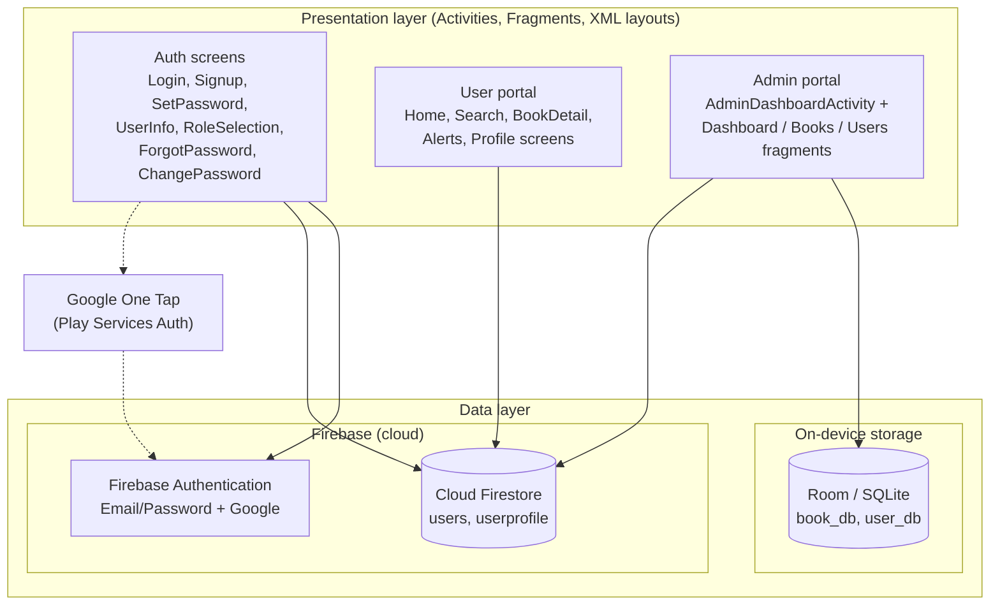
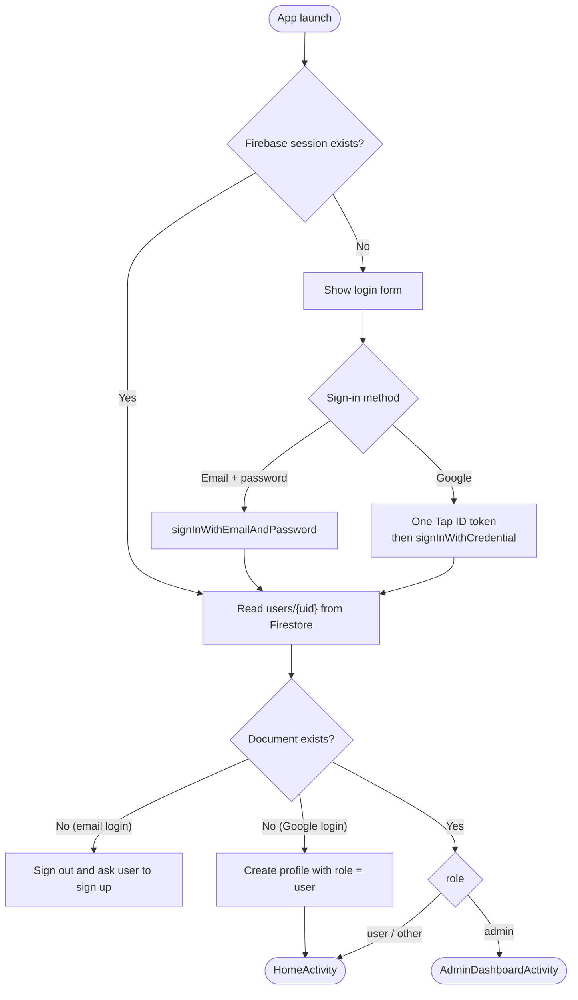
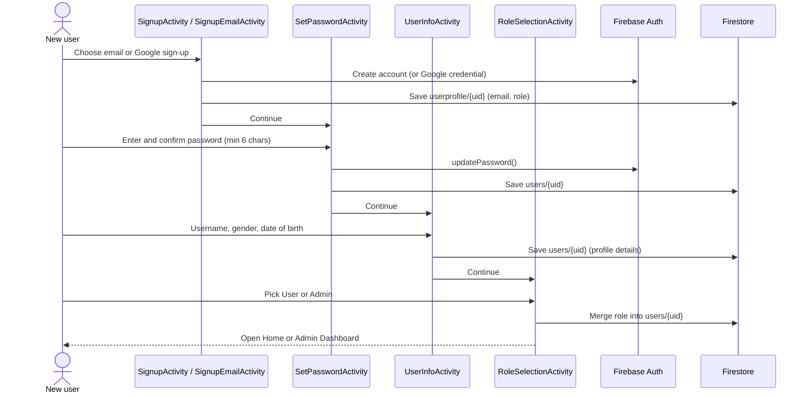
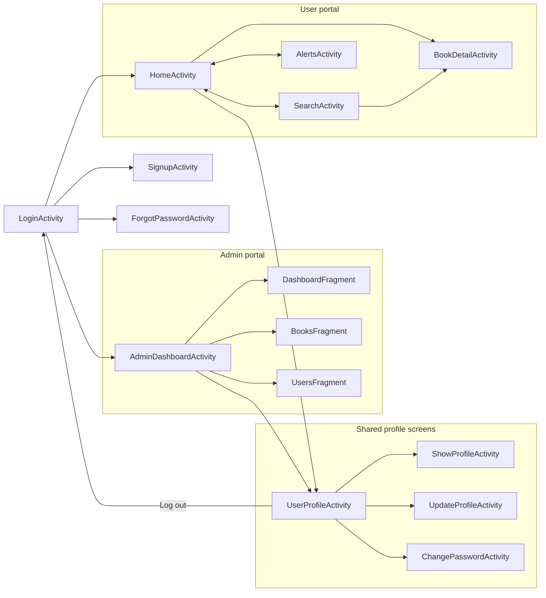
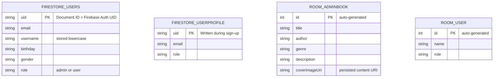

<div align="center">


# FolioVerse

**A role-based Android library app: browse and discover books as a reader, manage the catalogue and members as an admin.**


</div>

---

## Table of Contents

- [Overview](#overview)
- [Features](#features)
- [Screenshots](#screenshots)
- [System Design](#system-design)
  - [Architecture](#architecture)
  - [Authentication and Role Routing](#authentication-and-role-routing)
  - [Sign-Up Flow](#sign-up-flow)
  - [Screen Navigation](#screen-navigation)
  - [Data Model](#data-model)
- [Tech Stack](#tech-stack)
- [Project Structure](#project-structure)
- [Getting Started](#getting-started)
- [Known Limitations and Roadmap](#known-limitations-and-roadmap)
- [Team](#team)
- [License](#license)

---

## Overview

FolioVerse is a native Android application that models a digital library with two distinct portals behind a single login:

- **Readers (User portal)** discover books through genre browsing, a trending shelf and live search, and open a detail page for any title.
- **Librarians (Admin portal)** get a dashboard with a side navigation drawer for managing books and members.

Identity, sign-in and role storage run on **Firebase** (Authentication and Cloud Firestore). The admin tools persist their records on-device with **Room (SQLite)**. The UI is built with XML layouts and Material Components.

The project was built collaboratively as a team effort (see [Team](#team)).

## Features

### Authentication
| Capability | Details |
|---|---|
| Email and password sign-up | Collects username, gender and date of birth |
| Email and password login | Validated input, Firebase Authentication |
| Google Sign-In | One Tap flow; email and display name pulled from the Google account |
| Forgot password | Firebase password-reset email |
| Change password | Re-authenticates with the current password, or sends a reset email |
| Role-based routing | After login the stored role (`admin` or `user`) decides which portal opens |
| Persistent session | Returning users skip the login form and go straight to their portal |

### User portal
- **Home** with genre shelves (Fantasy, Humor, Horror, Mystery, Sci-Fi, Non-Fiction) and book covers
- **Search** by title or author as you type, plus genre filter tabs
- **Trending** horizontal carousel and suggested-stories list
- **Book detail** page: cover, title, author, genre and description
- **Notifications** screen with Notifications and Messages tabs
- **Profile** hub: show profile, update profile, change password, log out

### Admin portal
- **Dashboard** showing live totals of books and users
- **Manage Books**: add books (persisted in Room) with title, author, genre, description and a cover image picked from the device; edit and delete actions on each book card
- **Manage Users**: add, edit and remove user records with a role (all persisted in Room)
- **Side drawer** with the same profile options as the User portal and an exit confirmation dialog

## Screenshots

| Login | Home | Search |
|:---:|:---:|:---:|
|  |  |  |

| Book Detail | Admin Dashboard | Manage Books |
|:---:|:---:|:---:|
|  |  |  |

## System Design

### Architecture

The app is a single-module Android application. Activities and fragments talk to two data sources: Firebase for identity and profile data, and a local Room database for admin-managed records.



### Authentication and Role Routing

On launch, `LoginActivity` checks for an existing Firebase session. If there is none it shows the login form; either way the user's role is read from Firestore and used to choose the portal.



### Sign-Up Flow

New accounts are created with an email, then the user sets a password, fills in profile details and confirms their role.



### Screen Navigation



### Data Model

Two stores are used. Firestore holds account and profile data; Room holds the records managed from the admin portal.



| Store | Collection / table | Used for |
|---|---|---|
| Cloud Firestore | `users/{uid}` | Profile details and the role that drives portal routing |
| Cloud Firestore | `userprofile/{uid}` | Email and role captured at sign-up |
| Room (`book_db`) | `adminBook` | Books added by the admin, including cover image URI |
| Room (`user_db`) | `User` | Member records managed by the admin |

## Tech Stack

| Area | Technology |
|---|---|
| Language | Java 11 |
| UI | XML layouts, Material Components, ConstraintLayout, RecyclerView, DrawerLayout, BottomNavigationView |
| Authentication | Firebase Authentication (Email/Password) and Google One Tap via Play Services Auth |
| Cloud database | Cloud Firestore |
| Local database | Room 2.6.1 (SQLite) |
| Build | Gradle (Kotlin DSL), Android Gradle Plugin 8.9.2, Google Services plugin |
| SDK levels | `minSdk 24`, `targetSdk 35`, `compileSdk 35` |

## Project Structure

```text
FolioVerse-LibrarySystem/
├── app/
│   └── src/main/
│       ├── java/com/example/folioverse/
│       │   ├── LoginActivity.java            # Entry point, auth + role routing
│       │   ├── SignupActivity.java           # Sign-up entry (email / Google)
│       │   ├── SignupEmailActivity.java
│       │   ├── SetPasswordActivity.java
│       │   ├── UserInfoActivity.java         # Username, gender, DOB
│       │   ├── RoleSelectionActivity.java
│       │   ├── ForgotPasswordActivity.java
│       │   ├── ChangePasswordActivity.java
│       │   ├── HomeActivity.java             # User portal home
│       │   ├── SearchActivity.java           # Live search + genre filters
│       │   ├── BookDetailActivity.java
│       │   ├── AlertsActivity.java           # Notifications / messages
│       │   ├── UserProfileActivity.java      # Profile hub (shared)
│       │   ├── ShowProfileActivity.java
│       │   ├── UpdateProfileActivity.java
│       │   ├── AdminDashboardActivity.java   # Admin shell with nav drawer
│       │   ├── DashboardFragment.java        # Totals
│       │   ├── BooksFragment.java            # Book CRUD
│       │   ├── UsersFragment.java            # User CRUD
│       │   ├── *Adapter.java                 # RecyclerView adapters
│       │   ├── AdminBook.java, BookDao.java, BookDatabase.java   # Room: books
│       │   ├── User.java, UserDao.java, UserDatabase.java        # Room: users
│       │   └── Book.java, UserProfile.java, AlertItem.java       # Models
│       ├── res/                              # Layouts, drawables, menus, themes
│       └── AndroidManifest.xml
├── docs/assets/                              # README assets
├── gradle/                                   # Version catalog + wrapper
├── build.gradle.kts
├── settings.gradle.kts
└── LICENSE
```

## Getting Started

### Prerequisites

- **Android Studio** (a recent release that supports Android Gradle Plugin 8.9.x)
- **JDK 17** (the one bundled with Android Studio works)
- An Android emulator or device running **Android 7.0 (API 24)** or higher
- A **Google account** to create a Firebase project

### 1. Clone the repository

```bash
git clone https://github.com/Muntaha-Shahab/FolioVerse-LibrarySystem.git
cd FolioVerse-LibrarySystem
```

### 2. Create and connect a Firebase project

The Firebase config file is intentionally **not** committed (it is listed in `.gitignore`), so you need to supply your own.

1. Open the [Firebase Console](https://console.firebase.google.com/) and create a project.
2. Add an **Android app** with the package name `com.example.folioverse`.
3. Add your debug **SHA-1** fingerprint (needed for Google Sign-In):
   ```bash
   ./gradlew signingReport
   ```
4. Download **`google-services.json`** and place it in the `app/` directory:
   ```text
   app/google-services.json
   ```
5. In **Build > Authentication > Sign-in method**, enable **Email/Password** and **Google**.
6. In **Build > Firestore Database**, create a database. For development, start in test mode, then tighten the rules before sharing the app (see [Roadmap](#known-limitations-and-roadmap)).
7. Google Sign-In reads `default_web_client_id` from `app/src/main/res/values/strings.xml`. Replace it with the **Web client ID** from your own Firebase project (Authentication > Sign-in method > Google > Web SDK configuration).

### 3. Build and run

1. Open the project in Android Studio and let Gradle sync.
2. Select a device or emulator and press **Run**, or from the terminal:
   ```bash
   ./gradlew assembleDebug
   ```

### 4. Create an admin account

Roles are stored in Firestore. Sign up normally and pick **Admin** on the role-selection screen, or edit the `role` field of your document in `users/{uid}` to `admin` from the Firebase Console. Log in again and you will land on the Admin Dashboard.

## Known Limitations and Roadmap

This started as a team project, and the list below is an honest account of where it stands and what would make it production-ready.

**Security**
- [ ] Assign roles on the server side (Firestore Security Rules or Firebase custom claims) instead of letting the client choose its own role
- [ ] Replace the temporary password used during email sign-up with email verification or an email-link flow
- [ ] Add Firestore Security Rules that restrict each user to their own `users/{uid}` document

**Data and architecture**
- [ ] Move the book catalogue to Firestore so admin-added books appear in the User portal (today the reader catalogue and trending shelf are built-in sample data, and admin records live only on the device)
- [ ] Persist book edit and delete through `BookDao` (they currently update the on-screen list only), and handle books without a cover image in the edit dialog
- [ ] Move Room access off the main thread and adopt `ViewModel` and `LiveData` or `Flow`
- [ ] Drive the genre shelves on the Home screen from data instead of per-book click handlers
- [ ] Back Notifications with real data, and make the trending shelf data-driven rather than a static list
- [ ] Remove unused or duplicate dependencies (for example the Realtime Database artifact and repeated `firebase-auth` entries)

**Features and quality**
- [ ] Implement "Read Now" and "Add to Library" on the book detail page
- [ ] Add unit and instrumentation tests and a CI workflow
- [ ] Add a screenshots gallery and release APK

## Team

| Name | GitHub |
|---|---|
| **Muntaha Shahab** | [@Muntaha-Shahab](https://github.com/Muntaha-Shahab) |
| **Tehreem Naveed** | |
| **Eman Hamid** | |

## License

Distributed under the MIT License. See [`LICENSE`](LICENSE) for details.
